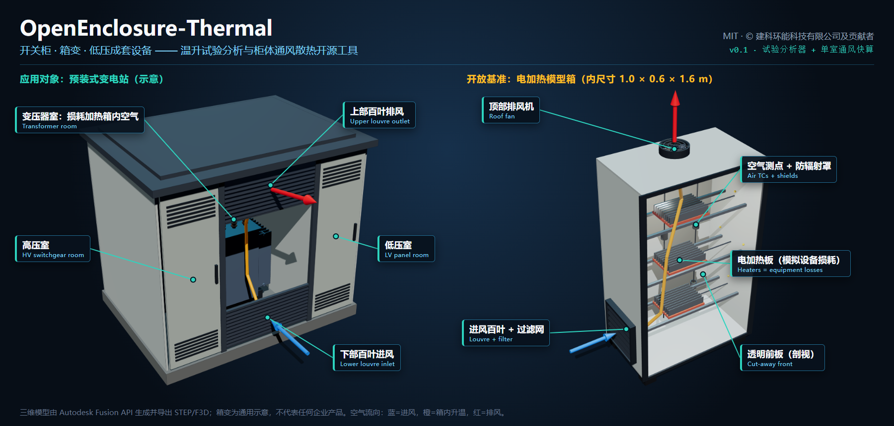
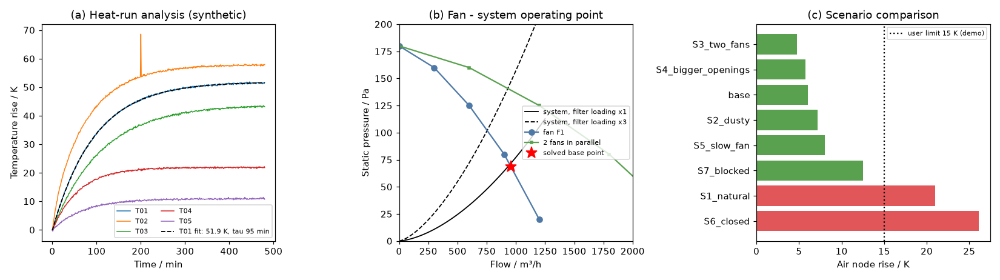

# OpenEnclosure-Thermal

**Open tools for temperature-rise test analysis and ventilation design of switchgear, prefabricated substations and low-voltage enclosures.**  
*开关柜、箱变与低压成套设备的温升试验分析和柜体通风散热开源工具*

English | [中文版 (Simplified Chinese)](README.zh-CN.md)

[](LICENSE)
[)](https://pypi.org/project/openenclosure-thermal/)


[GitHub Repository](https://github.com/wangzhichao-jpg/OpenEnclosure-Thermal) · [Gitee Mirror](https://gitee.com/bigtaurus/OpenEnclosure-Thermal)

> **Current Status: v0.1 Development Version (0.1.0.dev0).** The temperature-rise test analyser and single-zone ventilation fast-solver are implemented, with software verification (L0) completed on analytical solutions and synthetic benchmarks.  
> There is currently no prediction-accuracy claim on real physical equipment; an open electric heating benchmark model box campaign (L2) is planned (see [Experimental Plan](docs/开放模型箱基准试验方案.md)).

**In a nutshell:** Transform temperature-rise test curves into reusable thermal parameters, and compare enclosure openings, fan sizing, and filter configurations using a coupled fan–resistance–thermal equilibrium model.



## Intended Audience and Use Cases

- **Design Engineers of Switchgear, Package Substations & Low-Voltage Enclosures**: Rapid screening and parameter calculation for natural ventilation openings, filter selection, and exhaust fan operating point matching.
- **Type-Test and Inspection Engineers of Electrical Enclosure Assemblies**: Data-quality screening, ambient temperature-rise baseline alignment, thermal time-constant extraction, and steady-state stabilization verification.
- **Enclosure Structural and Thermal R&D Engineers**: Evaluating equilibrium air temperature rise under internal component heat dissipation, external solar irradiation (sol-air temperature), and flow resistance prior to physical prototyping.

## Key Capabilities (What v0.1 Can Do)

### 1. Temperature-Rise Test Analyser (`oet analyze-test`)

| Capability | Description |
|---|---|
| Data Ingestion | CSV/Excel formats; supports timestamps, seconds, minutes, hours; maps raw column names to sensor IDs; supports °C, K, °F. |
| Quality Screening | Inverted timestamps, duplicates, irregular intervals, missing values, frozen sensor values, clamped values, out-of-range limits, and step spikes. Raw files are never modified; every excluded data point is logged in an audit trail. |
| Rise Curves | Sensor temperature minus ambient reference (single sensor or multi-sensor average); maximum and final temperature rises, heating rates, t50 / t63 / t90 metrics. |
| Stability Criteria | **Defined explicitly by the user** (window size, maximum variation, maximum rate of change, and normative citation); no standard criteria are hardcoded. |
| Parameter Identification | Single-sensor first-order response: steady-state rise Δθ∞, thermal time constant τ, standard errors, and parameter covariance; under-developed curves trigger warnings or rejection. |
| Current–Rise Relation | Identifies current exponent n under identical physical configurations with ≥2 current levels; rejects identification on single-level data; no extrapolation by default. |
| Run Comparison | Direct deltas and curve deviations between matching sensors across prototype revisions, with optional event-offset alignment. |
| Limit Checking | Compares solely against **user-entered limits with cited sources**; never issues automated "pass / fail" verdicts. |
| Traceable Reporting | HTML, Excel, JSON exports; records software build version, input file SHA-256 hashes, source data classification, user criteria, warnings, and rejection logs. |

### 2. Single-Zone Enclosure Ventilation Calculator (`oet ventilate`)

| Capability | Description |
|---|---|
| Ventilation Regimes | Sealed enclosure, natural ventilation (thermal buoyancy), forced mechanical fan ventilation (with aiding or opposing buoyancy), or user-specified airflow. |
| Flow Resistances | Openings and louvers (flow coefficient K or discharge coefficient Cd), air filters (nominal flow vs. pressure drop, power-law exponent, dust loading multiplier). |
| Fans | Solves intersection between fan characteristic curves and system resistance; parallel fan stages; affinity-law speed scaling; **curves are never extrapolated by default**. |
| Envelope & Solar | Directional wall U-values; external solar radiation heat gain incorporated via sol-air temperatures. |
| Scenario Ranking | Multi-scenario sorting by air temperature rise, airflow volume, fan power, and margin to allowable limits; non-convergent configurations are retained with documented causes. |
| Parametric Sweeps | 1D parameter sweeps; single-factor sensitivity analysis across heat dissipation, ambient temperature, opening area, filter dust loading, fan stages, and solar flux. |

**Note:** Calculated results represent the **well-mixed enclosure air node temperature**, not the localized hotspot temperature of busbars, primary contacts, or transformer windings.

## Quick Start

### Installation

Python 3.11 or 3.12 is recommended:

```bash
# Install development pre-release from PyPI
python -m venv .venv
source .venv/bin/activate        # Windows: .venv\Scripts\activate
pip install -i https://pypi.tuna.tsinghua.edu.cn/simple openenclosure-thermal --pre

# Or install from local source in editable mode
pip install -i https://pypi.tuna.tsinghua.edu.cn/simple -e .
```

### Running Examples

```bash
oet init demo                                    # Generate synthetic demonstration case
oet analyze-test demo/switchgear_test/switchgear_test.yaml --compare R1:R2 -o out_test
oet ventilate demo/box_ventilation/box_ventilation.yaml -o out_box

oet template test test_template.xlsx             # Spreadsheet templates
oet template box  box_template.xlsx
```

For detailed guides, refer to [docs/快速上手.md](docs/快速上手.md); for governing equations and physical scope, see [docs/模型说明.md](docs/模型说明.md).



Example terminal output (synthetic benchmark):

```text
基准方案：空气节点 41.06 °C，温升 6.06 K，进风量 937.3 m³/h
  1. S3_two_fans: 温升 4.73 K，风量 1282 m³/h
  ...
  7. S1_natural:  温升 20.97 K，风量 70 m³/h
  8. S6_closed:   温升 26.13 K，风量 0 m³/h
```

## Validation and Current Status

### What It Does Not Promise

- Does not substitute for formal type testing, certification, or accredited laboratory evaluations; never issues automated "pass / fail" verdicts.
- Does not bundle copyright-protected standard clauses or tables from IEC, GB, or IEEE; allowable limits and stabilization thresholds must be supplied by the user with verifiable sources.
- Does not compute electromagnetic Joule/eddy losses from 3D conductor geometry; heat loss must be user-provided or extracted from test data.
- Is not a CFD solver; high-fidelity 3D flow fields will be interfaced in future releases via automated OpenFOAM case generation and validation.
- Fitting quality is not equivalent to predictive accuracy: reports clearly distinguish between software verification, calibration curve reproduction, and hold-out condition predictions.

### Verification Status

| Level | Content | Status |
|---|---|---|
| L0 Software Verification | Analytical benchmarks (sealed box, fixed flow rate, linear fan–resistance intersection, sol-air temperature), synthetic parameter recovery, physical monotonicity, and rejection heuristics. | ✅ 61 automated tests |
| Upstream Comparison | Mutual reproduction against [switchgear-thermal-model](https://github.com/alliander-opensource/switchgear-thermal-model) (MPL-2.0, optional dependency) under identical parameters. | ✅ Optional tests |
| L2 Open Benchmark | Planned open experimental campaign on an electric heating model box (in the environmental chamber of Jianke Environment and Energy Technology Co., Ltd.). | 📋 [Plan](docs/开放模型箱基准试验方案.md) · [Illustrative CAD STEP](docs/cad/benchmark_model_box_illustrative.step) |
| L3 Industry Pilots | Proprietary equipment datasets under written authorization. | Not started |

### Roadmap

v0.2 transient load & climate profiles, multi-test joint calibration, hold-out prediction → v0.3 multi-compartment substation networks & transformer additional rise, local GUI → v0.4 open benchmark datasets & OpenFOAM bridge → v1.0. See [docs/路线图.md](docs/路线图.md).

## Documentation, Citation, and License

### Data and Collaboration

The public repository contains solely original source code, synthetic benchmark cases, and licensed open datasets. Proprietary industrial test data should be flagged as `enterprise_private` and retained locally; `oet check-release` prevents private records, local file paths, and credentials from entering release packages.  
To collaborate on model calibration, scenario comparison, or open benchmark co-construction using proprietary test data, please open an Issue. See [docs/数据与合作.md](docs/数据与合作.md).

### Author and Citation

Project Lead: [Zhichao Wang](https://github.com/wangzhichao-jpg) (ORCID: [0000-0001-6662-835X](https://orcid.org/0000-0001-6662-835X)).  
If referencing this software in academic papers or engineering reports, please cite via [CITATION.cff](CITATION.cff) (the GitHub **Cite this repository** widget exports BibTeX and APA formats). If this tool aids your work, giving a Star on GitHub or [Gitee](https://gitee.com/bigtaurus/OpenEnclosure-Thermal) helps other engineers find it.

- Inquiries, Feedback & Public Data: Welcome via [GitHub Issues](https://github.com/wangzhichao-jpg/OpenEnclosure-Thermal/issues) or [Gitee Issues](https://gitee.com/bigtaurus/OpenEnclosure-Thermal/issues).
- Cooperation and Inquiries: [wangzhichao@chinaibee.com](mailto:wangzhichao@chinaibee.com)

### License and Maintenance

MIT License, Copyright (c) 2026 Jianke Environment and Energy Technology Co., Ltd. (建科环能科技有限公司) and contributors (see [LICENSE](LICENSE)). Third-party dependency notices are listed in [THIRD_PARTY_NOTICES.md](THIRD_PARTY_NOTICES.md).

Initiated and maintained by Jianke Environment and Energy Technology Co., Ltd. Contributions of algorithms, validation benchmarks, and open datasets from individuals and organizations are warmly welcomed.
