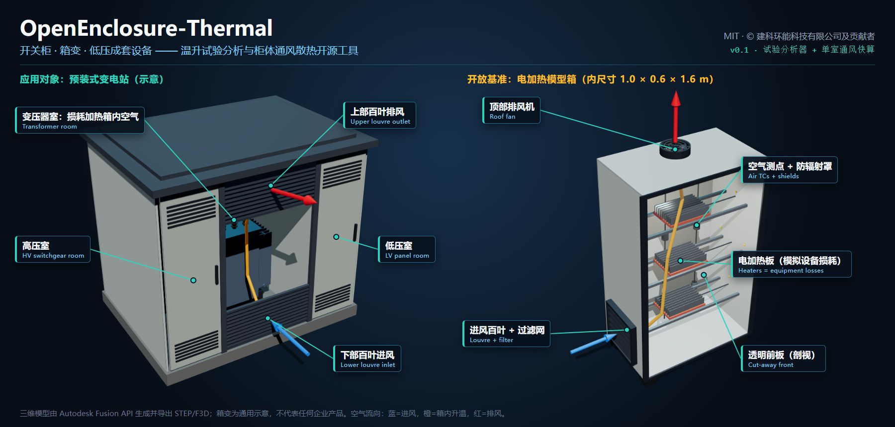
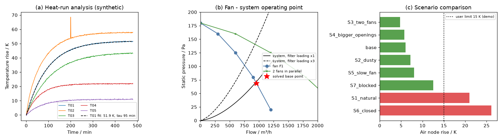

# OpenEnclosure-Thermal

**开关柜、箱变与低压成套设备的温升试验分析和柜体通风散热开源工具**  
*Open tools for temperature-rise test analysis and ventilation design of switchgear, prefabricated substations and low-voltage enclosures.*

简体中文 | [English](README.md)

[](LICENSE)
[)](https://pypi.org/project/openenclosure-thermal/)


[GitHub 仓库](https://github.com/wangzhichao-jpg/OpenEnclosure-Thermal) · [Gitee 仓库](https://gitee.com/bigtaurus/OpenEnclosure-Thermal)

> **当前状态：v0.1 开发版（0.1.0.dev0）。** 已实现温升试验分析器和单室通风快算，在解析解和合成数据上完成软件验证（L0）。
> 尚无真实设备的预测精度结论；电加热模型箱公开基准试验（L2）在规划中，见[试验方案](docs/开放模型箱基准试验方案.md)。

**一句话：** 把温升试验曲线整理成可复用的热参数，并用风机—阻力—热平衡模型比较箱体开口、风机和过滤网方案。



## 适用人群与用途

- **开关柜、箱式变电站与低压成套设备设计人员**：用于箱体自然通风开口、过滤网选型及排风机工况匹配的方案比选与参数快算。
- **成套电气设备型式试验与检验分析人员**：用于温升试验曲线的数据质量排查、环境温升对齐、热时间常数与稳定状态辨识。
- **电气设备结构与散热研发工程师**：用于在样机试制前评估发热损耗、日照辐射（sol-air 综合温度）与风阻特性的热平衡空气温升。

## 主要功能（v0.1 能做什么）

### 1. 温升试验分析器（`oet analyze-test`）

| 功能 | 说明 |
|---|---|
| 数据导入 | CSV/Excel；支持日期时间、秒、分钟、小时；原始列名映射到测点编号；°C/K/°F |
| 质量检查 | 时间倒序/重复/间隔异常、缺测、恒定值、卡值、超范围、跳点。原始文件不修改，每个被排除的点都写入日志 |
| 温升曲线 | 测点温度减去环境参考（单点或多点平均）；最高/最终温升、升温速率、t50/t63/t90 |
| 稳定判据 | **由用户设定**窗口、最大变化量、最大变化率和判据来源；软件不内置任何标准判据 |
| 参数识别 | 单测点一阶响应：稳态温升 Δθ∞、热时间常数 τ、标准误差、参数相关性；曲线未充分发展时给出警告或拒绝 |
| 电流—温升关系 | 同一配置、≥2 个电流水平时识别指数 n；只有 1 个电流水平时拒绝识别；默认不外推 |
| 试验对比 | 改进前后同名测点差值、曲线差，可按事件偏移对齐 |
| 限值比较 | 只与**用户录入并注明来源**的限值比较，不判定“合格/不合格” |
| 报告 | HTML、Excel、JSON；记录软件版本、输入文件 SHA-256、数据来源类型、判据、警告和拒绝项 |

### 2. 单室箱体通风快算（`oet ventilate`）

| 功能 | 说明 |
|---|---|
| 通风方式 | 封闭、自然通风（浮力）、风机强制通风（含浮力助推或削弱）、给定风量 |
| 阻力件 | 开口/百叶（K 或 Cd）、过滤网（额定风量—阻力、指数、积尘倍数） |
| 风机 | 风机曲线与系统阻力求交；并联台数；转速比按相似律换算；**默认不外推曲线** |
| 壁面与日照 | 用户给定各面 U 值；日照通过综合温度（sol-air）计入 |
| 方案比较 | 多方案排序（空气温升/风量/风机功率/限值裕量）；失败方案保留并注明原因 |
| 扫描与敏感性 | 一维参数扫描；发热、室外温度、开口面积、过滤网积尘、风机台数、日照的单因素敏感性 |

**注意：** 计算结果是**充分混合的箱内空气节点温度**，不是母排、触头或绕组的热点温度。

## 快速上手

### 安装

推荐 Python 3.11 或 3.12：

```bash
# 从 PyPI 安装开发预览版
python -m venv .venv
source .venv/bin/activate        # Windows: .venv\Scripts\activate
pip install -i https://pypi.tuna.tsinghua.edu.cn/simple openenclosure-thermal --pre

# 或从源码可编辑安装
pip install -i https://pypi.tuna.tsinghua.edu.cn/simple -e .
```

### 运行示例

```bash
oet init demo                                    # 生成合成示例
oet analyze-test demo/switchgear_test/switchgear_test.yaml --compare R1:R2 -o out_test
oet ventilate demo/box_ventilation/box_ventilation.yaml -o out_box

oet template test 温升试验模板.xlsx               # 中文 Excel 模板
oet template box  箱体通风模板.xlsx
```

详细说明见 [docs/快速上手.md](docs/快速上手.md)，方程和适用范围见 [docs/模型说明.md](docs/模型说明.md)。



示例运行结果（合成数据）：

```text
基准方案：空气节点 41.06 °C，温升 6.06 K，进风量 937.3 m³/h
  1. S3_two_fans: 温升 4.73 K，风量 1282 m³/h
  ...
  7. S1_natural:  温升 20.97 K，风量 70 m³/h
  8. S6_closed:   温升 26.13 K，风量 0 m³/h
```

## 验证与当前状态

### 不做的承诺

- 不替代型式试验、认证或认可检测；不自动判定“合格/不合格”。
- 不内置 IEC、GB 等受版权保护的标准条文或表格；限值和判据由用户录入并注明来源。
- 不从导体结构计算电磁损耗；发热量由用户输入，或由试验数据识别热参数。
- 不是 CFD 求解器；高保真分析将通过后续 OpenFOAM 案例生成与结果对照完成。
- 拟合效果不等于预测精度：报告区分软件验证、试验曲线复现和留出工况预测。

### 验证状态

| 层级 | 内容 | 状态 |
|---|---|---|
| L0 软件验证 | 解析解（封闭箱、给定风量、线性风机—阻力求交、日照综合温度）、合成数据参数恢复、物理方向一致性、拒绝规则 | ✅ 61 项自动测试 |
| 上游对照 | 与 [switchgear-thermal-model](https://github.com/alliander-opensource/switchgear-thermal-model)（MPL-2.0，可选依赖）在相同参数下互相复现 | ✅ 可选测试 |
| L2 开放基准 | 电加热模型箱公开试验（建科环能科技有限公司环境舱） | 📋 [方案](docs/开放模型箱基准试验方案.md) · [示意几何 STEP](docs/cad/benchmark_model_box_illustrative.step) |
| L3 企业试点 | 经书面授权的型号数据 | 未开始 |

### 路线图

v0.2 时变负荷与气候情景、多试验联合校准、留出预测 → v0.3 多隔室箱变网络与变压器附加温升、本地图形界面 → v0.4 开放基准数据与 OpenFOAM 桥接 → v1.0。见 [docs/路线图.md](docs/路线图.md)。

## 文档、引用与许可

### 数据与合作

公开仓库只包含原创代码、合成算例和许可清楚的公开数据。企业数据请设为 `enterprise_private` 并留在本地；`oet check-release` 会阻止私有数据、本机路径和凭据进入发布目录。
需要用自有试验数据做模型校准、方案比较或开放基准共建，可在 Issues 中联系。见 [docs/数据与合作.md](docs/数据与合作.md)。

### 作者与引用

项目负责人：[王智超](https://github.com/wangzhichao-jpg)（ORCID [0000-0001-6662-835X](https://orcid.org/0000-0001-6662-835X)）。
在论文或工程报告中使用本软件，请按 [CITATION.cff](CITATION.cff) 引用（GitHub 页面右侧 **Cite this repository** 可直接导出 BibTeX/APA）。如果对你有帮助，欢迎在 GitHub 或 [Gitee](https://gitee.com/bigtaurus/OpenEnclosure-Thermal) 点 Star，方便更多同行找到它。

- 问题反馈与公开数据合作：欢迎提交 [GitHub Issues](https://github.com/wangzhichao-jpg/OpenEnclosure-Thermal/issues) 或 [Gitee Issues](https://gitee.com/bigtaurus/OpenEnclosure-Thermal/issues)。
- 合作与咨询：[wangzhichao@chinaibee.com](mailto:wangzhichao@chinaibee.com)

### 许可与维护

MIT License，版权所有 © 2026 Jianke Environment and Energy Technology Co., Ltd. (建科环能科技有限公司) and contributors，见 [LICENSE](LICENSE)。第三方依赖见 [THIRD_PARTY_NOTICES.md](THIRD_PARTY_NOTICES.md)。

本项目由建科环能科技有限公司发起和维护，欢迎个人与机构贡献代码、算例和公开数据。
